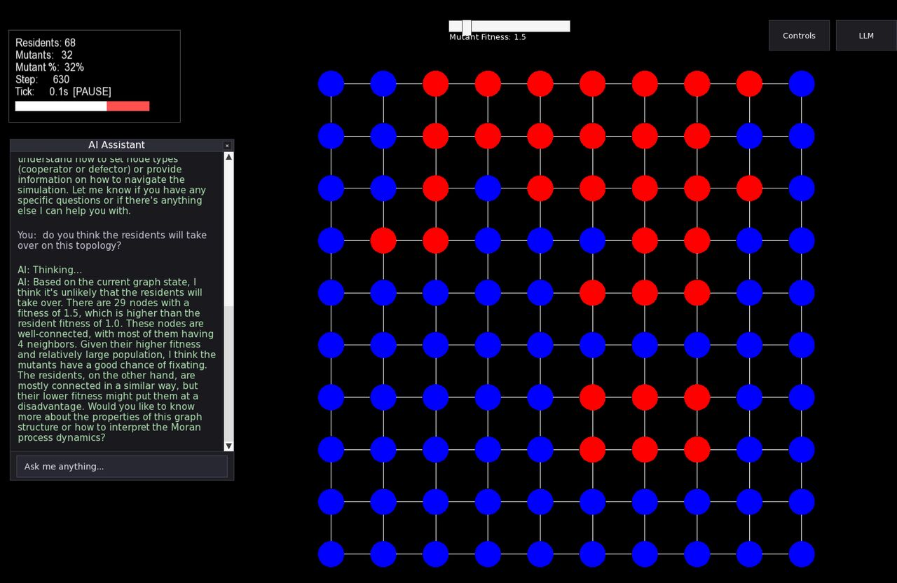
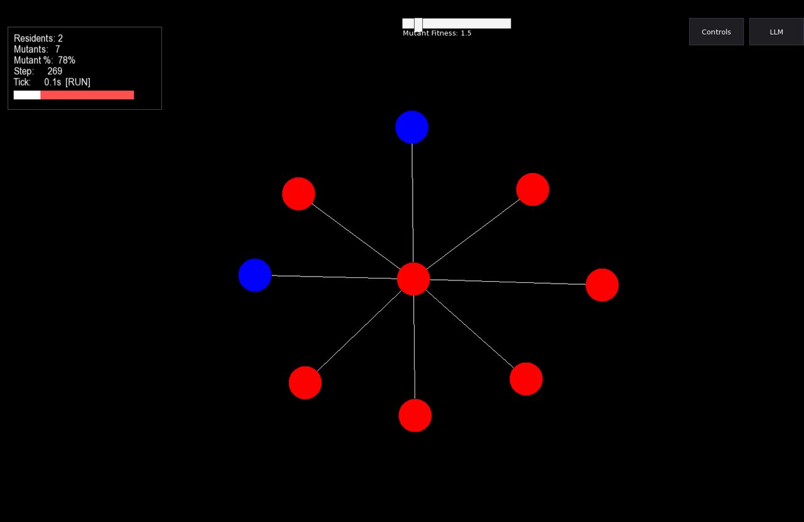

# Evolutionary Dynamics on Graphs - Interactive Simulation

An interactive C++ simulation for exploring evolutionary dynamics on graph networks, featuring an AI assistant powered by Groq to help you understand the simulation.

  
  

  <em><b>Left:</b> 10×10 lattice with the built-in AI assistant. The assistant answered based on the board at the time of the question; the screenshot was taken a few steps later, so the counts differ slightly. 
  <b>Right:</b> Star graph, a classic amplifier of selection, where advantageous mutants are more likely to take over the population.</em>

## 📋 Setup

### Prerequisites
- CMake 3.16+
- C++17 compiler
- SFML 3
- TGUI
- OpenSSL
- nlohmann_json

### Getting Started

1. **Get a Groq API Key**
   - Visit [Groq Console](https://console.groq.com)
   - Sign up and create an API key

2. **Configure Environment**
   - Copy `.env.example` to `.env`: `cp .env.example .env`
   - Edit `.env` and add your API key: `GROQ_API_KEY=your_actual_key`

3. **Build**
   - First time: `cmake -S . -B "build-name"`
   - Build: `cmake --build "build-name"`

4. **Run**
   - `./"build-name"/main`

## ⌨️ Controls

| Key | Action |
|-----|--------|
| **E** | Place node |
| **C** | Set cooperator |
| **F** | Set defector |
| **G** | Place grid |
| **Space** | Play/pause simulation |
| **Backspace** | Delete all & restart |
| **A/D** | Move camera left/right |
| **W/S** | Move camera up/down |
| **Scroll** | Zoom in/out |
| **Right Click + Drag** | Connect edges |

